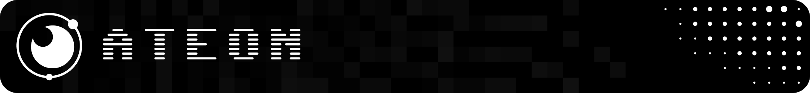
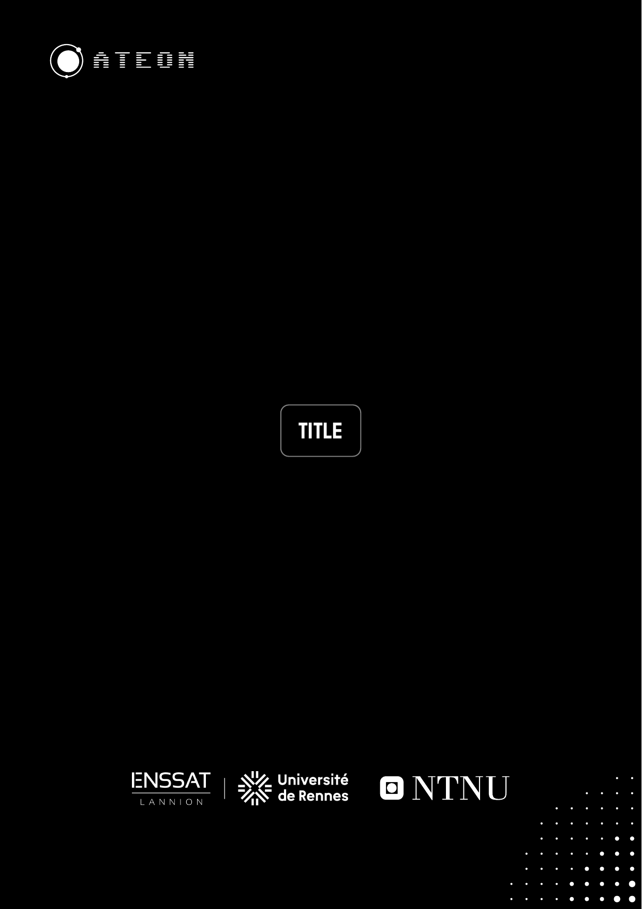
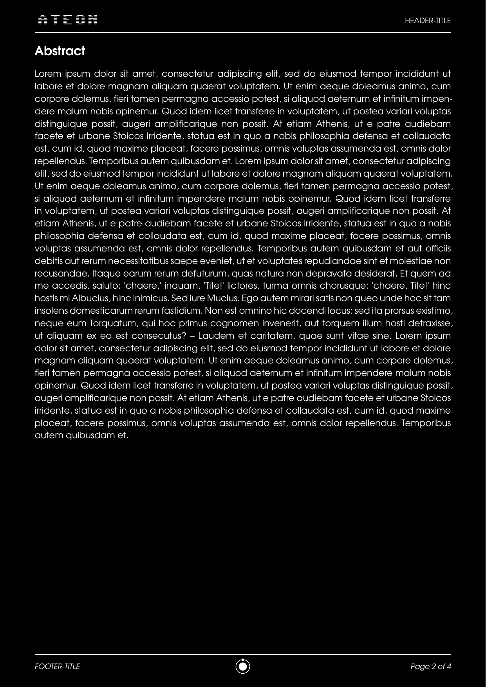
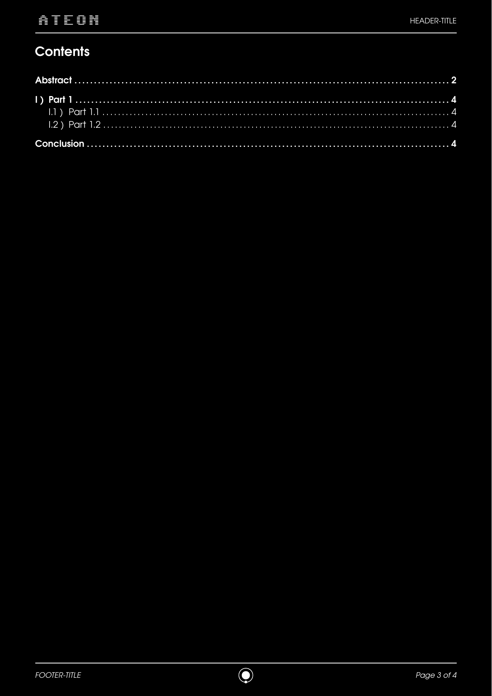
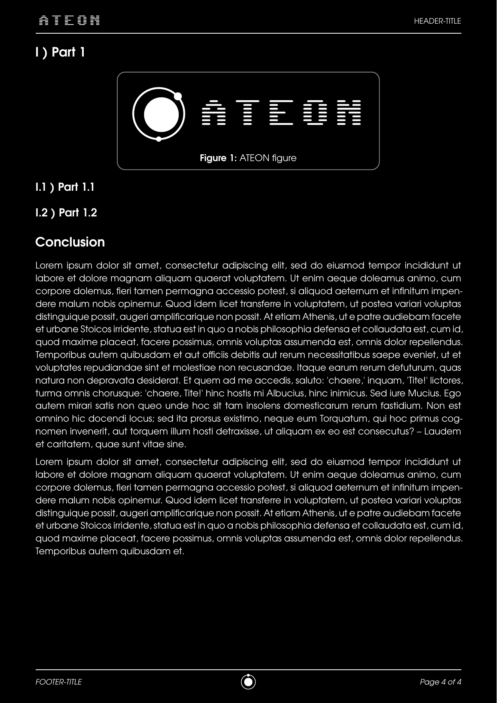
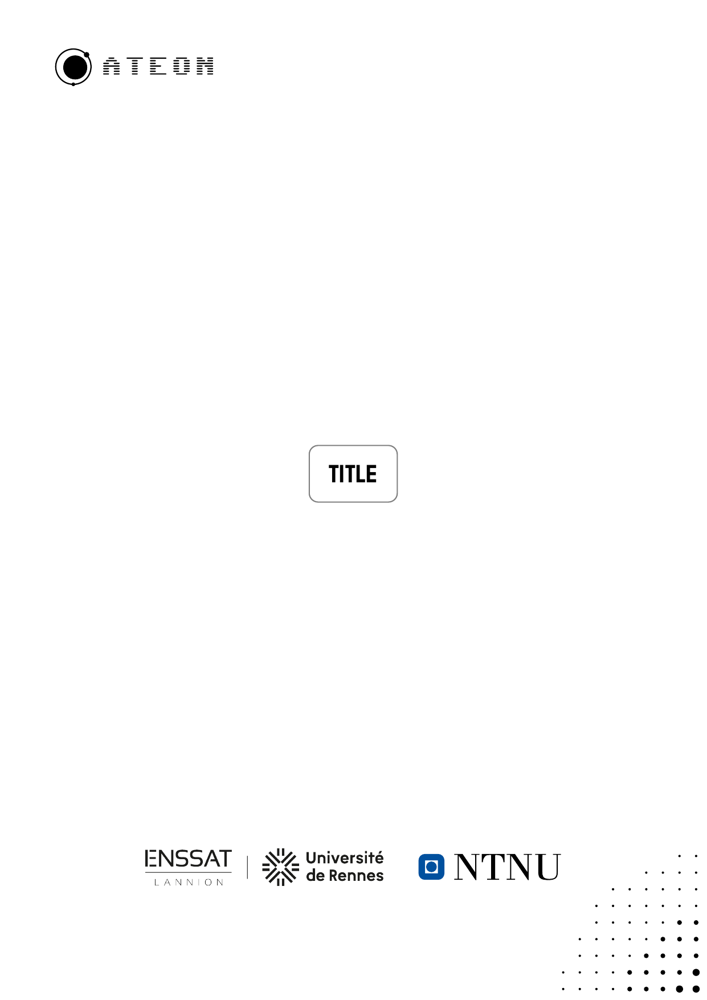
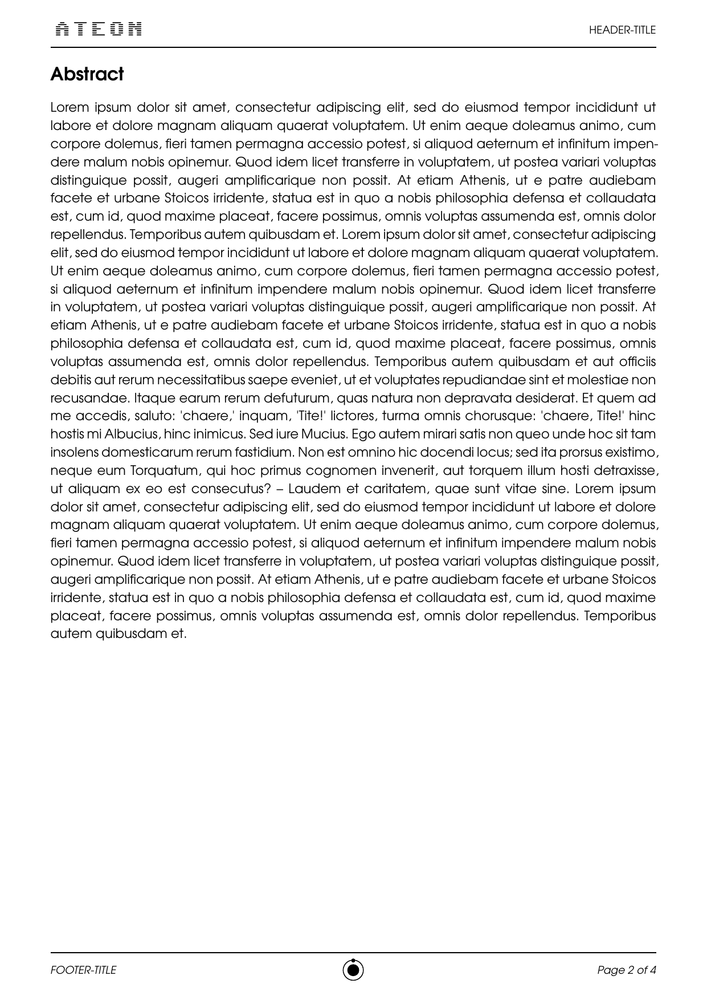
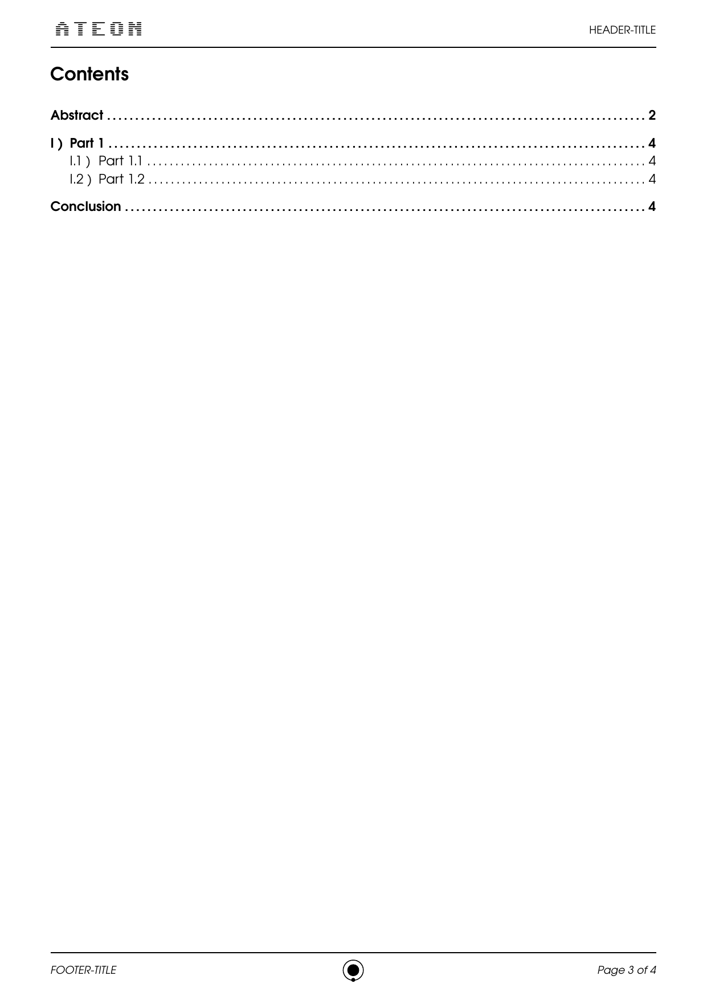
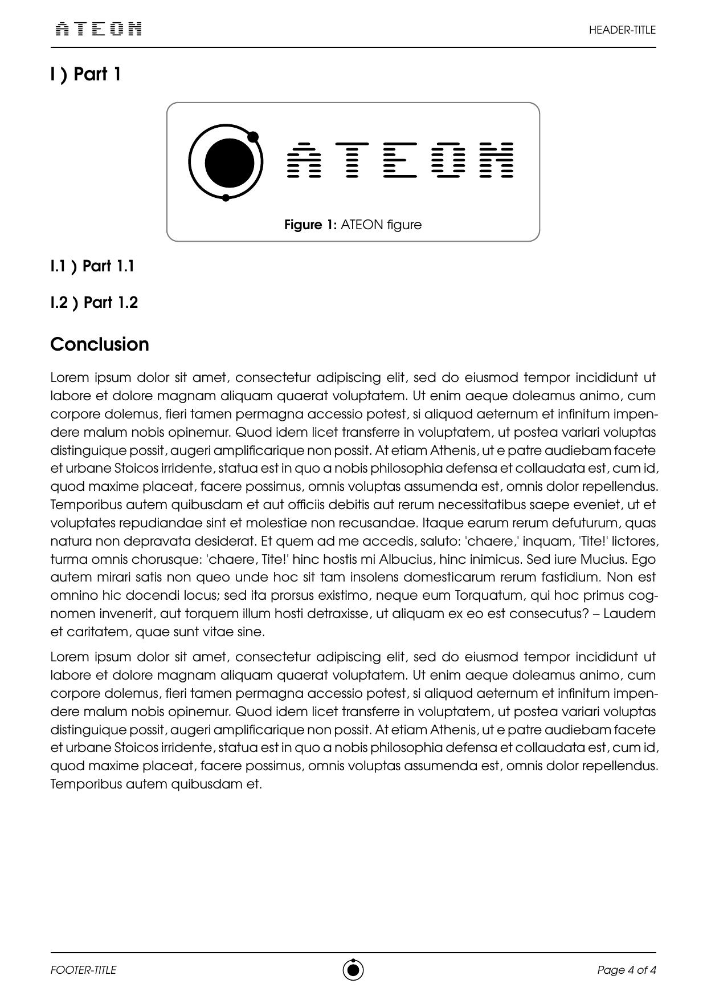

  

> A **minimalist Typst template** to create technical or personal documents with elegance and simplicity.
> Designed to be **lightweight, modular, and—above all—easy to customize** without the hassle.

## 🔑 Key Features
- **Dark Mode**: Perfect for late-night report writing sessions. 
- **Clean Design**: Modern and professional layout.
- **Easy Customization**: Adjust colors, fonts, and styles in just a few lines—no layers of complexity!

## 🛠 Installation
1. Download the template from this repo.
2. Open it with [Typst Web App](https://typst.app/) or your favorite IDE.
3. Customize it to fit your needs!

## 👀 Preview

<table>
  <tr>
    <td></td>
    <td></td>
    <td></td>
    <td></td>
  </tr>
  <tr>
    <td></td>
    <td></td>
    <td></td>
    <td></td>
  </tr>
</table>

